# Architecture

## C++20 Principles Applied

- **Concepts** — template constraints (`Updatable`, `Renderable`, `Damageable`)
- **`std::span`** — pass ranges without copies
- **RAII** everywhere — no raw `new`/`delete`, only `unique_ptr` / `shared_ptr`
- **Composition > inheritance** — `Entity` is a lightweight base; behaviors live in components
- **`std::variant` + `std::visit`** — State Machine without pure virtuals
- **Logic / render separation** — `defender_lib` has no display dependency

---

## Overview

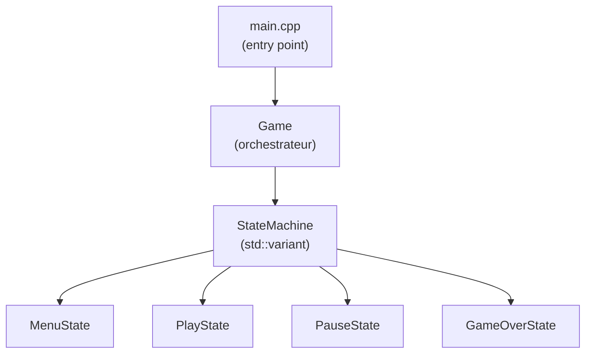

---

## Game State — PlayState

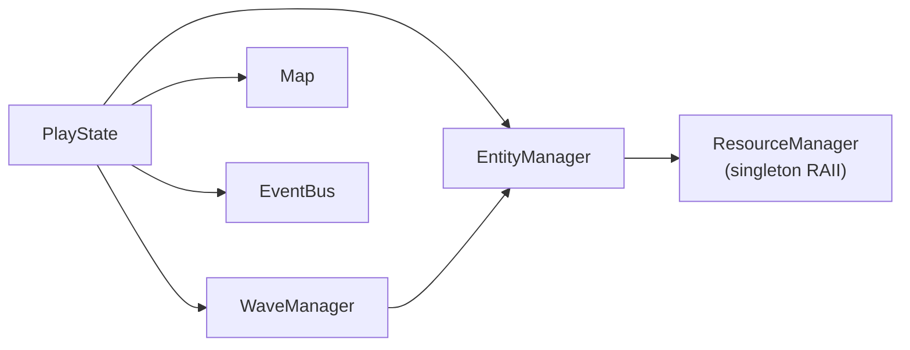

---

## Entity Hierarchy

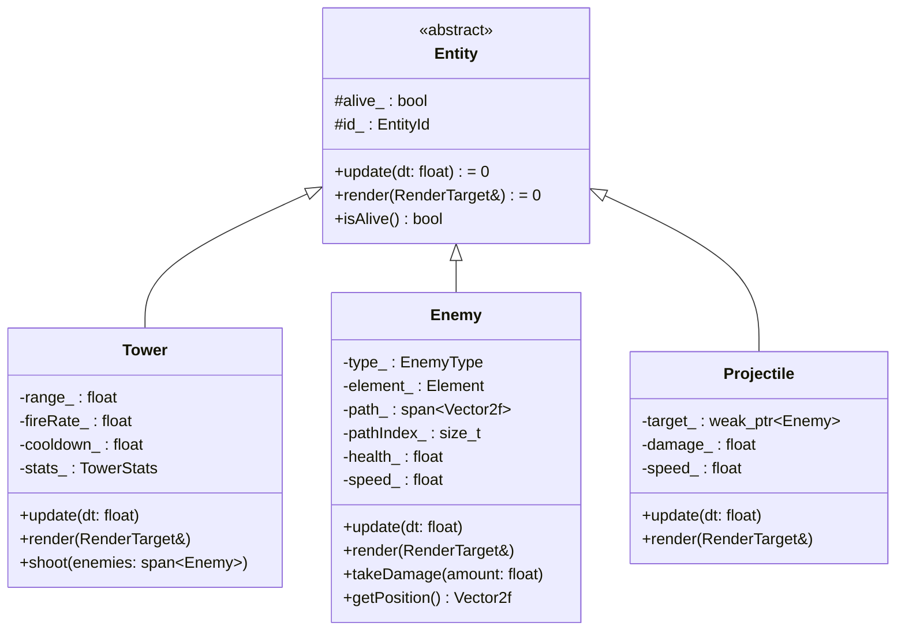

---

## C++20 Concepts

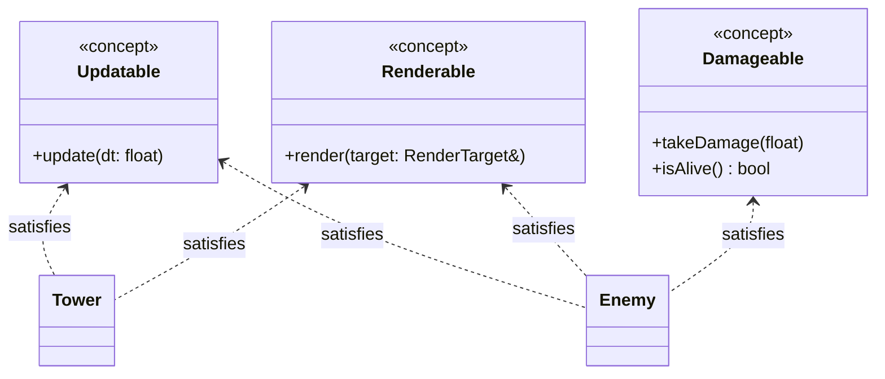

---

## EntityManager

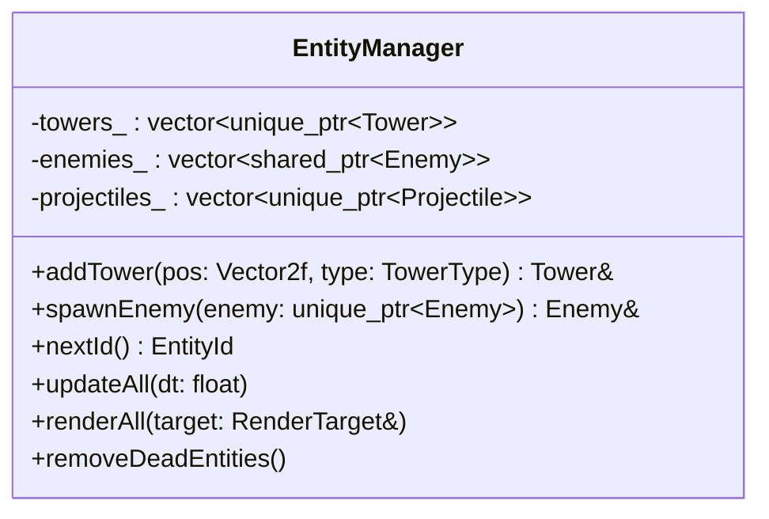

Enemies are `shared_ptr` so that `Projectile` can follow its target with a
`weak_ptr` and notice when it died.

---

## EnemyFactory

Creates enemies at random, following **probability matrices that depend on the
map's biome**. The species and the element are drawn independently:

`P(type, element | biome) = P(type | biome) × P(element | biome)`

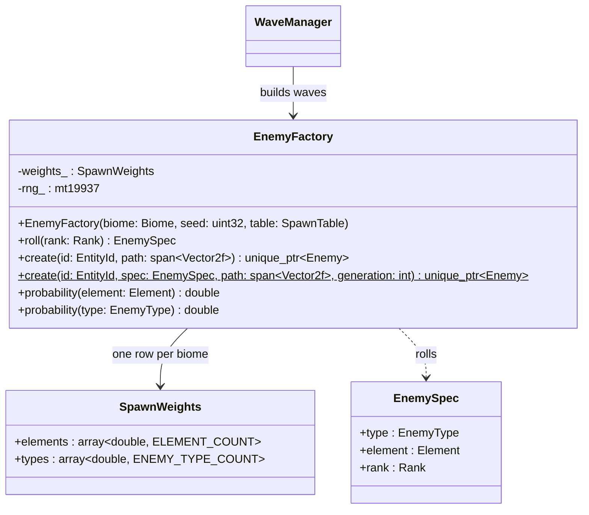

Default matrices (`src/entities/EnemyFactory.cpp`, in %):

| Biome   | Water | Fire | Earth | Wind |
|---------|------:|-----:|------:|-----:|
| Desert  |    10 |   35 |    35 |   20 |
| Ice     |    45 |    5 |    15 |   35 |
| Volcano |     5 |   50 |    35 |   10 |
| Forest  |    25 |   10 |    40 |   25 |

| Biome   | Octopus | Orangutan | Cat | Dog | Duck | Frog |
|---------|--------:|----------:|----:|----:|-----:|-----:|
| Desert  |       5 |        20 |  30 |  30 |    5 |   10 |
| Ice     |      20 |        10 |  15 |  20 |   25 |   10 |
| Volcano |      10 |        25 |  25 |  20 |   10 |   10 |
| Forest  |      10 |        30 |  15 |  15 |   15 |   15 |

!!! note "Never 0%"
    Every weight must be > 0. A `static_assert` rejects the default table at
    compile time otherwise, and the constructor throws `std::invalid_argument`
    for a custom table. Adding an element (ice, magma, lightning...) leaves a
    0 in every row until its column is filled, so it cannot be forgotten.

---

## Enemy definitions (stats + hooks)

An enemy is **species + element + rank**. All three are defined in C++, in
`src/entities/EnemyDefinitions.cpp`, and each one brings stats **and functions**.

```
final stat = base(species) × mult(element) × mult(rank) + add(element) + add(rank)
```

| Layer   | Struct               | Gives                                     |
|---------|----------------------|-------------------------------------------|
| Species | `SpeciesDefinition`  | base stats (`baseStats(hp, speed, gold, damage)`) + hooks |
| Element | `ModifierDefinition` | multipliers (`times`) + bonuses (`plus`) + hooks |
| Rank    | `ModifierDefinition` | multipliers (`times`) + bonuses (`plus`) + hooks |

Stats (`Stats.hpp`): `Health`, `Speed`, `Reward`, `Damage`, `Scale`.

### Hooks

`EnemyHooks` holds optional `std::function`s. The hooks of the three layers all
run, species first, then element, then rank:

| Hook          | Signature                              | When                          |
|---------------|----------------------------------------|-------------------------------|
| `onSpawn`     | `void(Enemy&)`                         | once, at creation             |
| `onUpdate`    | `void(Enemy&, float dt)`               | every frame while alive       |
| `onHit`       | `float(Enemy&, float damage)`          | before damage, returns the damage taken (chained) |
| `onDeath`     | `void(Enemy&, EnemySpawner&)`          | killed by damage              |
| `onReachBase` | `void(Enemy&)`                         | reaches the base              |

A hook can change the enemy (`enemy.stats()[Stat::Speed] *= 1.3f`, `enemy.heal(5)`),
and remember things in `enemy.memory(0..3)`. Ready-made hooks: `armor(n)`,
`regeneration(hpPerSecond)`, `splitInto(count, rank)`.

```cpp
{.description = "Dog: runs 30% faster once below half health.",
 .base = baseStats(80.f, 125.f, 8.f, 1.f),
 .hooks = {.onUpdate = [](Enemy& dog, float) {
     float& enraged = dog.memory(0);
     if (enraged == 0.f && dog.health() < dog.maxHealth() * 0.5f) {
         enraged = 1.f;
         dog.stats()[Stat::Speed] *= 1.3f;
     }
 }}},
```

### Current definitions

| Layer      | Effect |
|------------|--------|
| Orangutan  | slow tank, armor 2 |
| Cat        | fast, survives its first deadly hit with 1 hp |
| Dog        | +30% speed below half health |
| Water      | +5 gold, regenerates 2 hp/s |
| Fire       | ×1.15 speed, ×0.9 health |
| Earth      | ×1.3 health, ×0.85 speed, armor 2 |
| Wind       | ×1.3 speed, ×0.8 health |
| Mini-boss  | ×4 health, ×3 gold/damage, ×0.9 speed, size ×1.4 |
| Boss       | ×12 health, ×10 gold, ×5 damage, ×0.75 speed, armor 3, size ×1.9 |
| Super boss | ×25 health, ×20 gold, ×10 damage, ×0.6 speed, armor 5, size ×2.4, splits into 3 mini-bosses |

Armor removes `n` from each hit but always lets 20% through; armor hooks stack.

### Super boss split

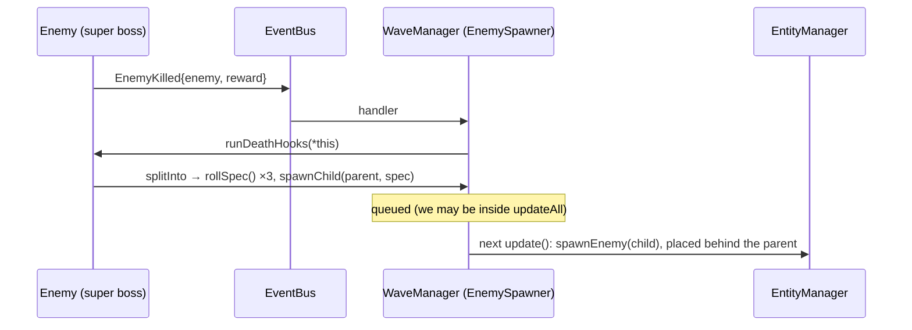

Children keep the element, roll their species with the biome matrices, and get
`generation + 1`; splitting stops at `MAX_SPAWN_GENERATION` (3). A wave is not
complete while children are waiting to spawn.

### Wave composition

`WAVE_RULES` (`EnemyDefinitions.hpp`): 30 enemies in wave 1, +5 per wave, every
10th enemy is a mini-boss, the last one is a super boss, 0.7 s between spawns.

---

## WaveManager

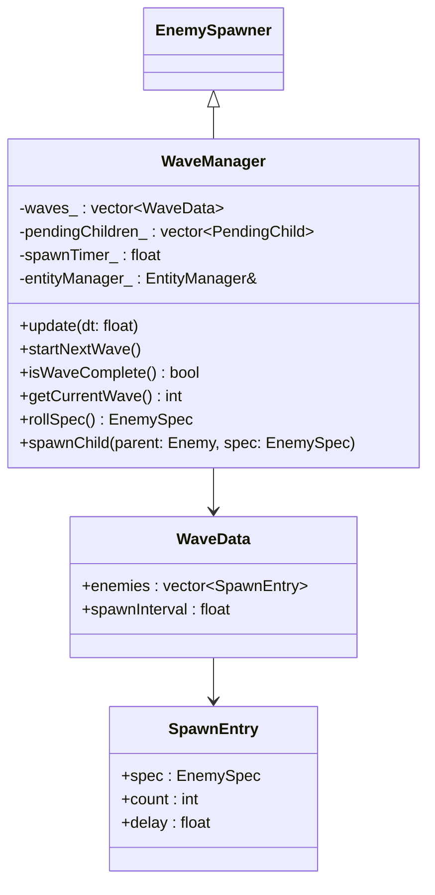

---

## EventBus (Decoupling)

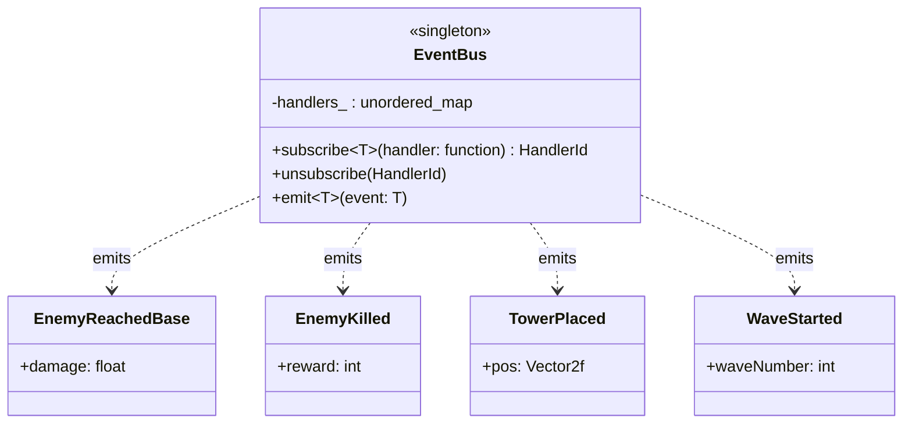

---

## ResourceManager

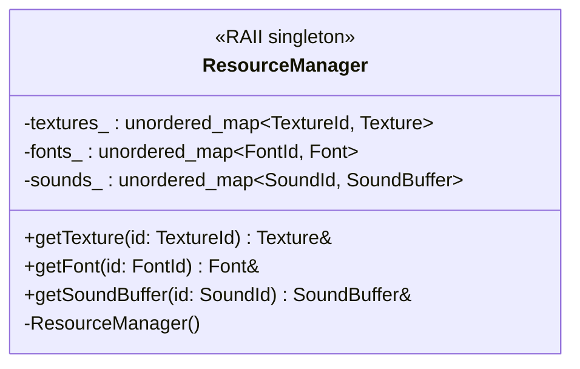

---

## Game Loop

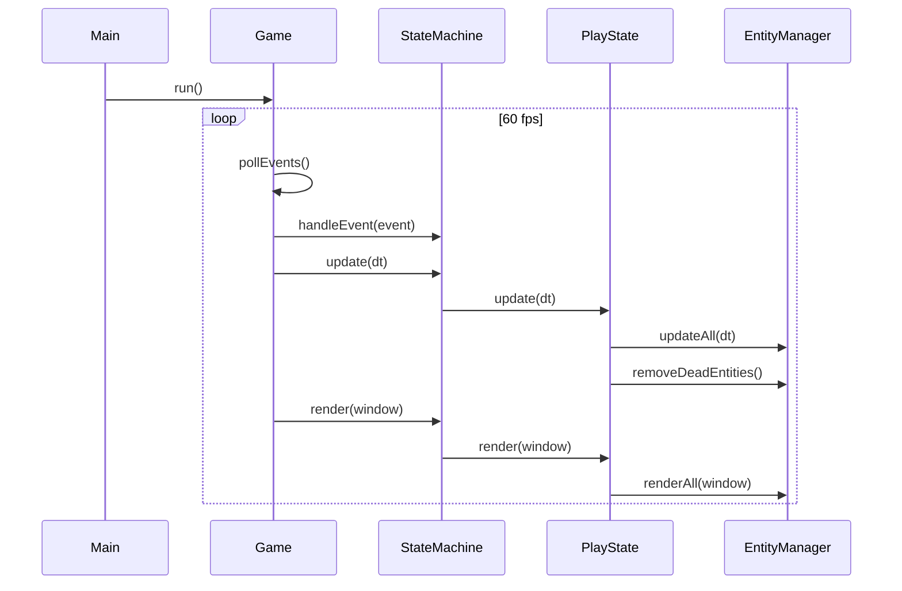

---

## File Structure

Headers live in `include/defender/<folder>/`, sources in `src/<folder>/`.

```
src/
├── core/
│   ├── Game.hpp / Game.cpp
│   ├── StateMachine.hpp          ← std::variant<MenuState, PlayState, ...>
│   ├── EventBus.hpp              ← template header-only
│   ├── Events.hpp                ← EnemyKilled, WaveStarted...
│   └── Concepts.hpp              ← Updatable, Renderable, Damageable
├── states/
│   ├── MenuState.hpp / .cpp
│   ├── PlayState.hpp / .cpp
│   ├── PauseState.hpp / .cpp
│   └── GameOverState.hpp / .cpp
├── entities/
│   ├── Types.hpp                 ← Element, EnemyType, Rank, EnemySpec
│   ├── Stats.hpp                 ← Stat, EnemyStats
│   ├── EnemyDefinitions.hpp / .cpp ← species/element/rank stats + hooks, wave rules
│   ├── Entity.hpp                ← abstract base
│   ├── Tower.hpp / .cpp
│   ├── Enemy.hpp / .cpp
│   ├── EnemyFactory.hpp / .cpp   ← biome probability matrices
│   └── Projectile.hpp / .cpp
├── managers/
│   ├── EntityManager.hpp / .cpp
│   ├── WaveManager.hpp / .cpp
│   └── ResourceManager.hpp / .cpp
├── map/
│   ├── Tile.hpp                  ← TileType, Biome, GridPos
│   ├── Map.hpp / .cpp
│   ├── Maze.hpp / .cpp           ← perfect maze (recursive backtracker)
│   ├── MapGenerator.hpp / .cpp
│   └── MapRenderer.hpp / .cpp
└── defender_lib.cpp              ← CMake stub
```
